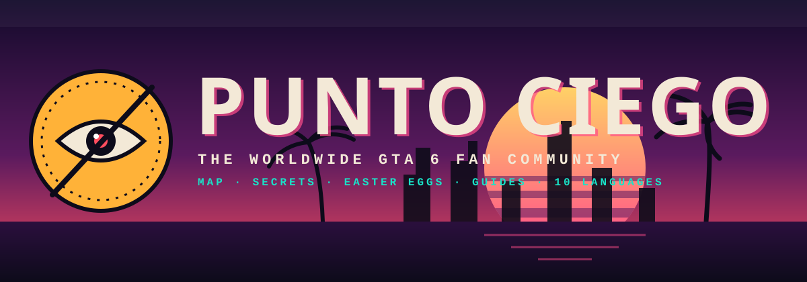
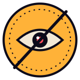
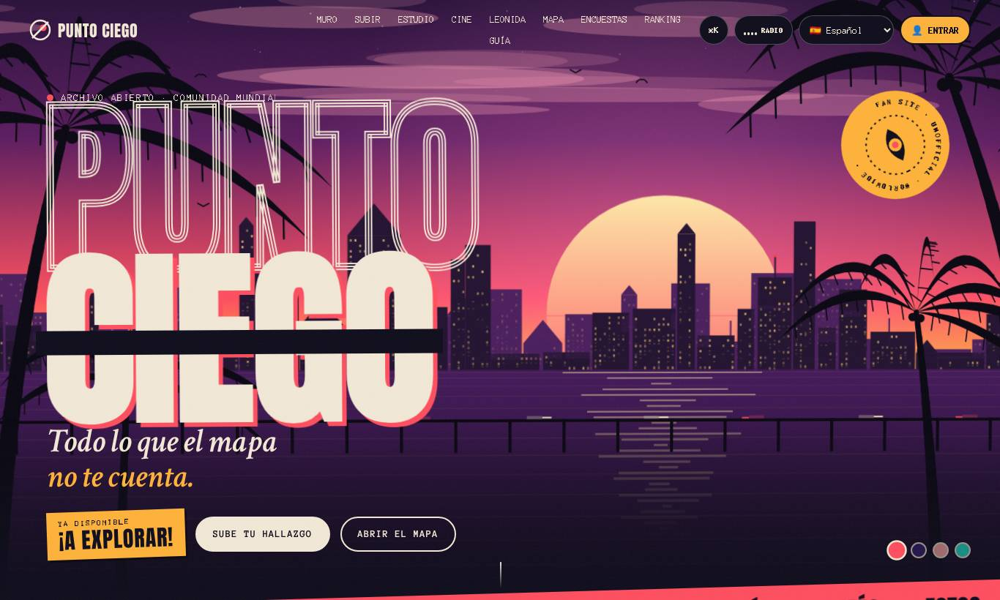
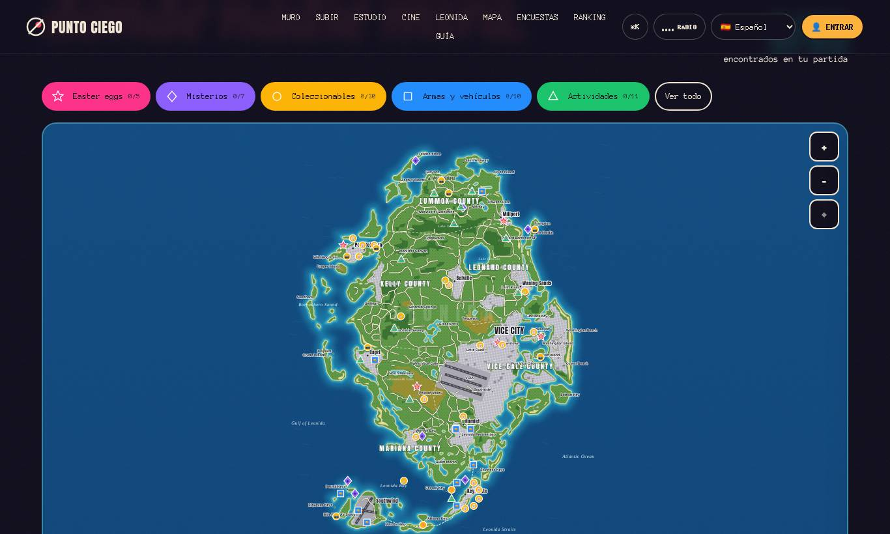
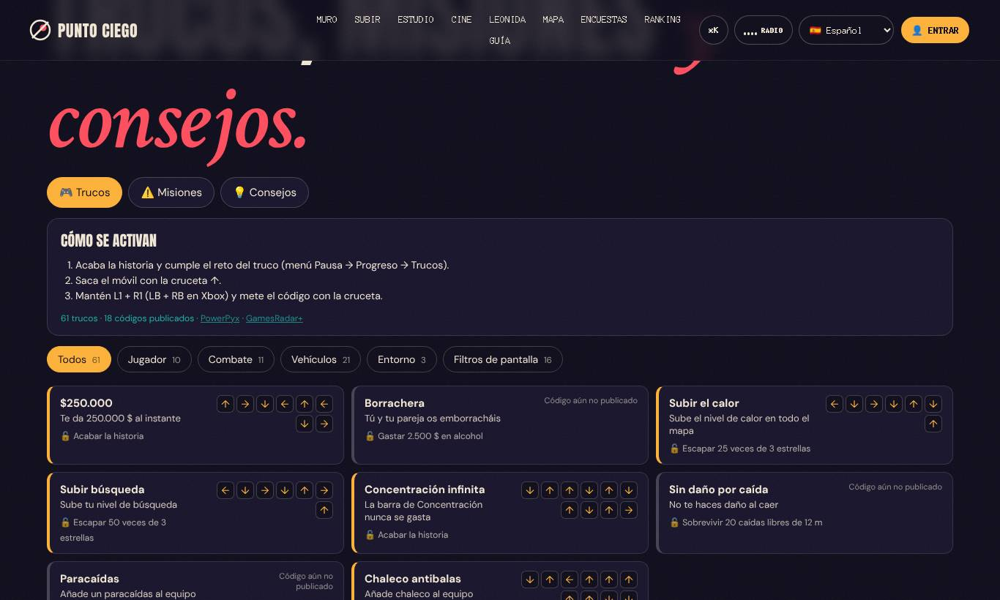
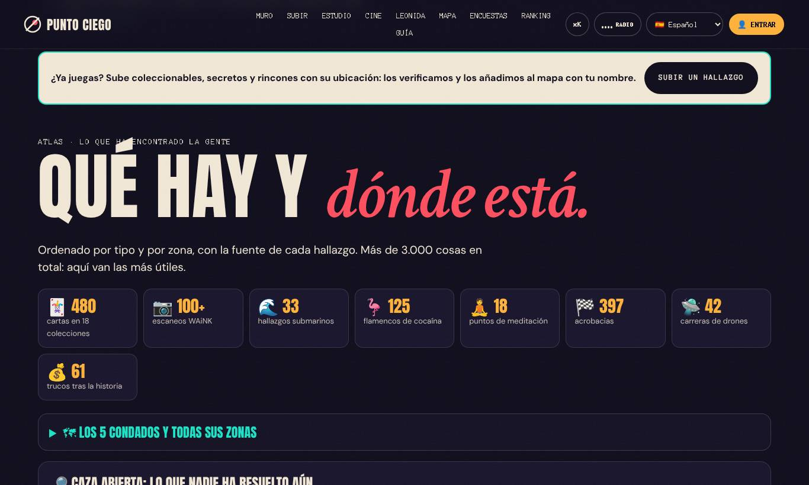
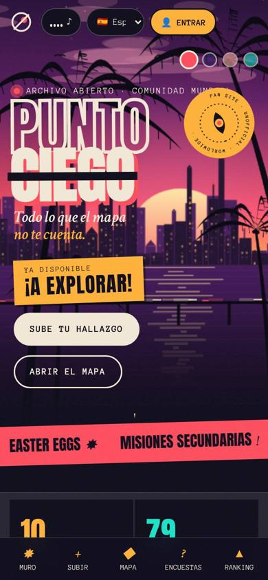
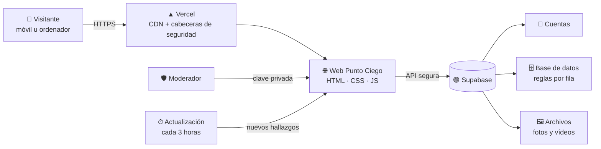

 

# Punto Ciego

**La comunidad fan de GTA 6 para todo el mundo.**
Mapa interactivo de Leonida, secretos, easter eggs, guías, trucos y lo que descubren los jugadores, en 10 idiomas.

---

> [!NOTE]
> 🚧 **Proyecto en creación.** Punto Ciego crece cada día: nuevos hallazgos cada 3 horas, nuevas funciones cada semana. Este repositorio es el escaparate del proyecto. El código de la web es privado.

---

## 📑 Índice

- [Qué es Punto Ciego](#-qué-es-punto-ciego)
- [Capturas](#-capturas)
- [Funciones](#-funciones)
- [Cómo está hecha](#-cómo-está-hecha)
- [Arquitectura](#-arquitectura)
- [Seguridad](#-seguridad)
- [Contenido siempre al día](#-contenido-siempre-al-día)
- [Idiomas](#-idiomas)
- [Rendimiento y accesibilidad](#-rendimiento-y-accesibilidad)
- [Hoja de ruta](#-hoja-de-ruta)
- [Legal](#-legal)
- [Créditos y contacto](#-créditos-y-contacto)

---

## 👁 Qué es Punto Ciego

Punto Ciego es una **web fan no oficial** de *Grand Theft Auto VI*. Reúne lo que van descubriendo los jugadores de todo el mundo: dónde está cada coleccionable, cada easter egg, cada misterio y cada arma escondida.

La comunidad es la que le da vida. Cualquiera con una cuenta puede subir sus fotos y clips del juego, comentar y dar "me gusta". Todo lo que se sube pasa por moderación antes de publicarse.

> Si lo has visto en Leonida y nadie más lo sabe, compártelo aquí.

---

## 📸 Capturas

| Portada | Mapa de Leonida |
|:---:|:---:|
|  |  |
| **Guía: trucos y misiones** | **Atlas de hallazgos** |
|  |  |

*Diseñada primero para el móvil*

---

## ✨ Funciones

### 🗺 Mapa de Leonida
- Dibujo propio con la geografía real del juego: costa, islas, lagos, pantanos, ciudades, aeropuertos y red de carreteras.
- Los **5 condados**: Kelly, Lummox, Leonard, Vice-Dale y Mariana, con más de 60 zonas con nombre.
- Pines separados por **forma y color**:
  - ⭐ Easter eggs
  - 🔷 Misterios
  - 🟡 Coleccionables
  - 🟦 Armas y vehículos
  - 🔺 Actividades
- Zoom, desplazamiento, filtros por tipo y una ficha para cada hallazgo: dónde está, cómo conseguirlo y la fuente.
- Cada jugador puede marcar lo que ya ha encontrado y ver su progreso.

### 📚 Atlas de hallazgos
- Todo ordenado por tipo y por zona, con buscador.
- **Caza abierta:** misterios que nadie ha resuelto todavía. El primero en confirmarlo sale en la web.
- **Mi camino al 100%:** el contador personal de cartas, escaneos, flamencos, acrobacias y más.

### 🎮 Guía del modo historia
- **Los 61 trucos**: cómo se activan, qué hace cada uno y cómo se desbloquea.
- **Las 91 misiones** en sus 5 capítulos, con quién se juega cada una y un resumen breve.
- ⚠️ **Protección contra spoilers:** las misiones están ocultas tras un aviso. Cada fan elige por qué capítulo va y solo ve hasta ahí.
- Consejos prácticos para no perderte nada.

### 👥 Comunidad
- Cuentas gratuitas para cualquier país.
- Subida de fotos y vídeos con **categoría obligatoria**.
- Me gusta, comentarios, reportes, encuestas, reto semanal y ranking de exploradores.
- Panel de moderación privado para revisar y aprobar los envíos.

### 🎧 Extras
- Radio con música original generada en directo en el navegador, sin archivos de audio.
- Escenas animadas que cambian de color según la hora del día del visitante.
- Modo cine y paleta de comandos (`Ctrl + K`).

---

## 🛠 Cómo está hecha

| Parte | Tecnología |
|---|---|
| Interfaz | HTML5, CSS3 y JavaScript puro, sin frameworks |
| Gráficos | Canvas 2D y SVG generados por código |
| Sonido | Web Audio API (síntesis en tiempo real) |
| Cuentas y datos | Supabase (Auth + PostgreSQL + Storage) |
| Lógica del servidor | Funciones de PostgreSQL con permisos controlados |
| Alojamiento | Vercel (CDN global y HTTPS) |
| Mapa | Vectorizado a partir de la geografía conocida del juego |
| Empaquetado | Minificado y dividido en pocos archivos para cargar rápido |

> El código fuente es privado. Aquí se explica qué hace la web y cómo está montada, sin mostrar el código.

---

## 🧭 Arquitectura

---

## 🔒 Seguridad

La seguridad está en varias capas:

**En el navegador**
- Política de seguridad de contenidos (CSP) estricta: solo se carga código propio.
- La web no se puede incrustar en otras páginas, lo que frena el clickjacking.
- HTTPS obligatorio (HSTS) y aislamiento de ventanas.
- Sin acceso a cámara, micrófono, ubicación ni pagos.

**En las subidas**
- Las imágenes se vuelven a codificar antes de subirse: se borran los metadatos y la ubicación GPS, y cualquier cosa escondida dentro del archivo.
- Los vídeos se comprueban por su firma real, no solo por la extensión.
- Solo se admiten formatos concretos y un tamaño máximo.
- No se puede publicar sin cuenta ni sin categoría.

**En el contenido**
- Nada se publica sin aprobación del moderador.
- Filtro de palabras ofensivas y de odio en 10 idiomas.
- Se bloquean los nombres de usuario que suplantan a la web, a Rockstar o a figuras problemáticas.
- No se permiten enlaces en textos ni comentarios. Los vídeos solo pueden enlazar a YouTube, TikTok o Twitch.
- Los comentarios con 3 reportes se ocultan solos.
- El contenido de la comunidad no se puede descargar desde la web.

**En el servidor**
- Seguridad por fila en todas las tablas.
- Las acciones solo funcionan con la sesión iniciada.
- Límites de uso contra spam y abusos.
- Los datos privados (likes, votos, correos) están en un espacio que no es accesible desde fuera.
- La clave de moderación se guarda solo como huella cifrada.

---

## ⏱ Contenido siempre al día

Cada **3 horas** un proceso automático:

1. Revisa fuentes fiables publicadas tras el lanzamiento (guías y medios especializados).
2. Añade los nuevos hallazgos confirmados al Atlas y al mapa, con su ubicación y su fuente.
3. Completa códigos de trucos y resúmenes de misiones, sin desvelar giros de la historia.
4. Publica la actualización en la web.

Se descartan rumores, mapas de fans y webs especulativas.

---

## 🌍 Idiomas

🇪🇸 Español · 🇬🇧 English · 🇧🇷 Português · 🇫🇷 Français · 🇩🇪 Deutsch · 🇮🇹 Italiano · 🇳🇱 Nederlands · 🇵🇱 Polski · 🇹🇷 Türkçe · 🇯🇵 日本語

La web detecta el idioma del navegador y se puede cambiar en cualquier momento.

---

## ⚡ Rendimiento y accesibilidad

- Sin librerías externas pesadas: carga rápida incluso con mala cobertura.
- Versión móvil compacta, con carruseles y secciones plegables.
- Navegable con teclado y con textos alternativos.
- Respeta la opción de "reducir movimiento" del sistema.

---

## 🗺 Hoja de ruta

- [x] Mapa de Leonida con los 5 condados
- [x] Atlas de easter eggs, misterios y coleccionables
- [x] Guía de trucos y misiones con aviso de spoilers
- [x] Cuentas, subidas, comentarios y moderación
- [x] Actualización automática cada 3 horas
- [ ] Dominio propio
- [ ] Perfiles públicos con insignias de explorador
- [ ] Rutas guiadas por el mapa
- [ ] Notificaciones de nuevos hallazgos

---

## ⚖️ Legal

Punto Ciego es un proyecto fan **sin ánimo de lucro**, sin afiliación, patrocinio ni respaldo de Rockstar Games ni de Take-Two Interactive. *Grand Theft Auto*, *GTA* y sus marcas pertenecen a sus respectivos dueños.

El mapa y los gráficos están dibujados por Punto Ciego. Las fotos y los vídeos de la comunidad son de quienes los suben. La web cumple el RGPD, la LOPDGDD y la LSSI: tiene aviso legal, política de privacidad, política de cookies y términos de uso.

---

## 💌 Créditos y contacto

**Creado por Erik Puertas**

📧 [Ciegopunto10@gmail.com](mailto:Ciegopunto10@gmail.com) · 🌐 [punto-ciego-phi.vercel.app](https://punto-ciego-phi.vercel.app)

© 2026 Punto Ciego · Hecho con 🧡 para la comunidad de Leonida

